<!-- generated from profile.json by scripts/build.py — edit the config, not this file -->

<picture>
  <source media="(prefers-color-scheme: dark)" srcset="https://raw.githubusercontent.com/Peruere-dev/Peruere-dev/output/github-snake-dark.svg">
  
</picture>

